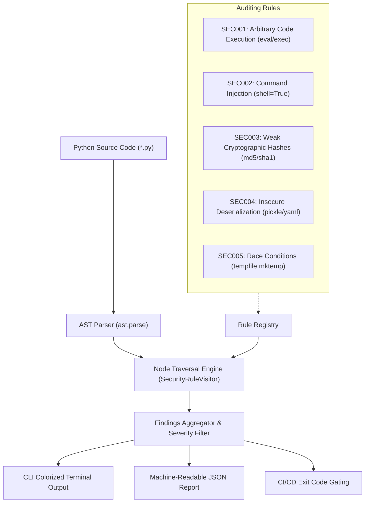

# 🛡️ AST-Sentinel

[](https://github.com/ScareCrowInMountain/ast-sentinel/actions/workflows/ci.yml)
[](https://www.python.org/)
[](https://opensource.org/licenses/MIT)
[](#)

A high-precision, lightweight static application security testing (SAST) auditor for Python codebases, driven by Python's native **Abstract Syntax Tree (AST)** engine. Zero external runtime dependencies required.

---

## 🎯 Purpose & Philosophy

Traditional regex-based grep tools frequently misfire—flagging comments, docstrings, or harmless variable names while missing obfuscated calls. **AST-Sentinel** parses Python source directly into AST nodes, conducting semantic code audits with:

1. **Contextual Accuracy**: Distinguishes actual function invocations from string literals and comments.
2. **Low False Positive Rate**: Understands defensive parameters (e.g., distinguishing `hashlib.md5(..., usedforsecurity=False)` from vulnerable usages).
3. **Zero Runtime Dependencies**: The core engine runs strictly on Python's standard library (`ast`, `argparse`, `dataclasses`).
4. **CI/CD Native**: Seamlessly returns appropriate POSIX exit codes and structured JSON output for automated security gates.

---

## 🏗️ Architecture



---

## 📋 Security Rules Matrix

| Rule ID | Name | CWE | Severity | Risk Description & Recommendation |
| :--- | :--- | :--- | :--- | :--- |
| **`SEC001`** | Dynamic Code Execution | [CWE-95](https://cwe.mitre.org/data/definitions/95.html) | `CRITICAL` | `eval()` or `exec()` invoked directly. Replace with safe evaluators (`ast.literal_eval`). |
| **`SEC002`** | Subprocess Command Injection | [CWE-78](https://cwe.mitre.org/data/definitions/78.html) | `HIGH` | `subprocess` call invoked with `shell=True`. Pass arguments as a list with `shell=False`. |
| **`SEC003`** | Weak Cryptographic Hash | [CWE-327](https://cwe.mitre.org/data/definitions/327.html) | `MEDIUM` | Insecure use of `MD5`/`SHA1`. Use SHA256 or set `usedforsecurity=False`. |
| **`SEC004`** | Insecure Deserialization | [CWE-502](https://cwe.mitre.org/data/definitions/502.html) | `HIGH` | Untrusted `pickle.loads()` or `yaml.load()` without SafeLoader. Use `yaml.safe_load()`. |
| **`SEC005`** | Insecure Temporary File | [CWE-377](https://cwe.mitre.org/data/definitions/377.html) | `MEDIUM` | `tempfile.mktemp()` is deprecated and prone to TOCTOU symlink races. Use `NamedTemporaryFile()`. |

---

## 🚀 Quick Start

### 1. Installation

Clone and install locally:

```bash
git clone https://github.com/ScareCrowInMountain/ast-sentinel.git
cd ast-sentinel
pip install -e .
```

### 2. Usage Examples

#### Scan a project or directory
```bash
# Audits current directory recursively
ast-sentinel .

# Filter by minimum severity threshold
ast-sentinel /path/to/project --severity HIGH

# Output as structured JSON (for pipelines & tooling)
ast-sentinel src/ --format json
```

#### List all registered rules
```bash
ast-sentinel --list-rules
```

---

## 🖥️ Sample Output

```text
    ___   _____ ______      _____            __   _            __
   /   | / ___//_  __/     / ___/___  ____  / /_ (_)___  ___  / /
  / /| | \__ \  / / ______ \__ \/ _ \/ __ \/ __// / __ \/ _ \/ / 
 / ___ |___/ / / / /_____/___/ /  __/ / / / /_ / / / / /  __/ /  
/_/  |_/____/ /_/        /____/\___/_/ /_/\__//_/_/ /_/\___/_/   
                                             v0.1.0
    Lightweight AST-Driven Static Security Code Auditor

[!] Audit complete: Found 5 potential issue(s) across 12 file(s) (0.04s):

1. [CRITICAL] [SEC001] [CWE-95] Arbitrary Code Execution
   File: backend/parser.py:42:15
   Risk: Use of built-in 'eval()' enables dynamic code evaluation, posing severe code injection risks.
   Code: eval(untrusted_payload)

2. [HIGH] [SEC002] [CWE-78] Subprocess Shell True
   File: scripts/deploy.py:18:4
   Risk: subprocess.Popen() invoked with shell=True is susceptible to command injection.
   Code: subprocess.Popen(f"curl {url}", shell=True)

Summary: CRITICAL: 1 | HIGH: 1 | MEDIUM: 3 | LOW: 0
```

---

## 🔄 CI/CD Security Gating

Incorporate AST-Sentinel into GitHub Actions to block vulnerable commits:

```yaml
- name: Run AST-Sentinel Security Audit
  run: |
    python3 -m ast_sentinel.cli . --severity HIGH
```
*AST-Sentinel automatically exits with status code `1` if any `HIGH` or `CRITICAL` findings are detected, failing the pipeline.*

---

## 🧪 Testing

The repository contains both positive (vulnerable) and negative (compliant) test vectors:

```bash
pytest -v
```

---

## 🛡️ Responsible Disclosure & Defensive Statement

AST-Sentinel is strictly built for defensive software engineering, static application security testing (SAST), and DevSecOps compliance verification. It helps developers locate and remediate unsafe code patterns before software reaches production.

## 📄 License

Licensed under the [MIT License](LICENSE). Copyright (c) 2026 ScareCrowInMountain.
