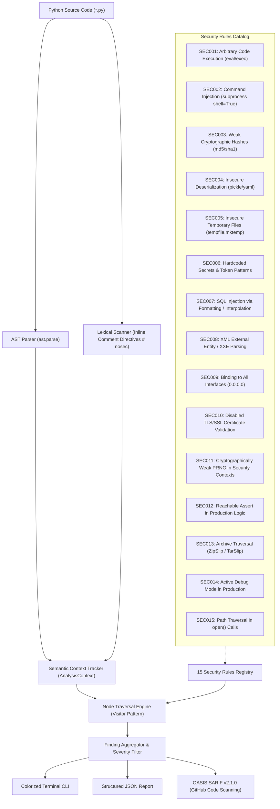

# 🛡️ AST-Sentinel

[](https://github.com/ScareCrowInMountain/ast-sentinel/actions/workflows/ci.yml)
[](https://www.python.org/)
[](https://opensource.org/licenses/MIT)
[](https://sarifweb.azurewebsites.net/)
[](#)

A high-precision, extensible static application security testing (SAST) auditor for Python codebases, powered by Python's native **Abstract Syntax Tree (AST)** engine. Features semantic scope & import alias resolution, inline `# nosec` suppressions, and native **OASIS SARIF v2.1.0** export for GitHub Code Scanning.

Zero external runtime dependencies required.

---

## 🎯 Purpose & Philosophy

Traditional regex-based grep tools frequently misfire—flagging comments, docstrings, or harmless variable names while missing obfuscated calls and import aliases. **AST-Sentinel** parses Python source code into syntactic trees and performs semantic analysis with:

1. **Import Aliasing & Scope Tracking**: Accurately tracks imported modules and symbol aliases (e.g. `import subprocess as sp; sp.call(..., shell=True)` and `from os import system as sys_exec`).
2. **Contextual Accuracy & Low False Positives**: Distinguishes actual callable nodes from string literals and comments, honoring security parameters (such as `usedforsecurity=False` in hashing and `filter="data"` in archive extraction).
3. **Inline Comment Suppressions**: Supports developer-guided triage using `# nosec`, `# nosec: SEC001`, or `# sentinel: ignore=SEC001`.
4. **Zero Runtime Dependencies**: The core analysis and traversal engine runs strictly on Python's standard library (`ast`, `argparse`, `dataclasses`).
5. **OASIS SARIF v2.1.0 & CI Native**: Seamlessly integrates into GitHub Actions, generating SARIF reports that directly populate GitHub's **Security > Code scanning alerts** tab.

---

## 🏗️ Architecture



---

## 📋 Comprehensive Security Rules Matrix

| Rule ID | Name | CWE | Severity | Risk Description & Recommendation |
| :--- | :--- | :--- | :--- | :--- |
| **`SEC001`** | Arbitrary Code Execution | [CWE-95](https://cwe.mitre.org/data/definitions/95.html) | `CRITICAL` | `eval()`, `exec()`, or `os.system()` invoked. Use `ast.literal_eval()` or explicit functions. |
| **`SEC002`** | Subprocess Command Injection | [CWE-78](https://cwe.mitre.org/data/definitions/78.html) | `HIGH` | `subprocess` call with `shell=True`. Pass arguments as a list with `shell=False`. |
| **`SEC003`** | Weak Cryptographic Hash | [CWE-327](https://cwe.mitre.org/data/definitions/327.html) | `MEDIUM` | Insecure use of `MD5`/`SHA1`. Use SHA256 or specify `usedforsecurity=False`. |
| **`SEC004`** | Insecure Deserialization | [CWE-502](https://cwe.mitre.org/data/definitions/502.html) | `HIGH` | Untrusted `pickle.loads()` or `yaml.load()` without SafeLoader. Use `yaml.safe_load()`. |
| **`SEC005`** | Insecure Temporary File | [CWE-377](https://cwe.mitre.org/data/definitions/377.html) | `MEDIUM` | `tempfile.mktemp()` is prone to TOCTOU symlink races. Use `NamedTemporaryFile()`. |
| **`SEC006`** | Hardcoded Secret Detection | [CWE-798](https://cwe.mitre.org/data/definitions/798.html) | `HIGH` | Hardcoded API keys, tokens, or credentials in source. Migrate to environment variables or secret vaults. |
| **`SEC007`** | SQL Injection | [CWE-89](https://cwe.mitre.org/data/definitions/89.html) | `HIGH` | Dynamic string formatting (`f-string`, `%`, `.format()`) in database queries. Use parameterized queries. |
| **`SEC008`** | XML External Entity (XXE) | [CWE-611](https://cwe.mitre.org/data/definitions/611.html) | `MEDIUM` | Standard XML parser susceptible to entity expansion. Use `defusedxml` packages. |
| **`SEC009`** | Binding to All Interfaces | [CWE-200](https://cwe.mitre.org/data/definitions/200.html) | `MEDIUM` | Binding socket or server to `0.0.0.0` or `::`. Bind to `127.0.0.1` unless public exposure is intended. |
| **`SEC010`** | Disabled SSL Verification | [CWE-295](https://cwe.mitre.org/data/definitions/295.html) | `HIGH` | TLS verification disabled (`verify=False` or unverified SSL contexts), enabling MitM attacks. |
| **`SEC011`** | Weak Randomness | [CWE-338](https://cwe.mitre.org/data/definitions/338.html) | `MEDIUM` | Standard `random` PRNG used for security tokens/keys. Use the `secrets` standard library module. |
| **`SEC012`** | Unsafe Assert Usage | [CWE-617](https://cwe.mitre.org/data/definitions/617.html) | `LOW` | `assert` statements used in production logic. Assertions are stripped in optimized mode (`python -O`). |
| **`SEC013`** | Archive Path Traversal | [CWE-22](https://cwe.mitre.org/data/definitions/22.html) | `HIGH` | `tarfile.extractall()` without safe filter (ZipSlip). Validate member paths or use `filter='data'`. |
| **`SEC014`** | Debug Mode Enabled | [CWE-489](https://cwe.mitre.org/data/definitions/489.html) | `HIGH` | Active debug mode (`debug=True` or `DEBUG = True`) exposing stack traces and interactive consoles. |
| **`SEC015`** | Path Traversal in open() | [CWE-22](https://cwe.mitre.org/data/definitions/22.html) | `MEDIUM` | Dynamic path interpolation in `open()`. Normalize and enforce directory boundaries using `pathlib.Path.resolve()`. |

---

## 🚀 Quick Start

### 1. Installation

Clone and install in editable mode:

```bash
git clone https://github.com/ScareCrowInMountain/ast-sentinel.git
cd ast-sentinel
pip install -e .
```

### 2. Basic Usage

```bash
# Audits current directory recursively
ast-sentinel .

# Filter by minimum severity threshold
ast-sentinel /path/to/project --severity HIGH

# Export OASIS SARIF report for GitHub Code Scanning
ast-sentinel src/ --format sarif --output results.sarif

# Output structured JSON
ast-sentinel src/ --format json

# List all active rules
ast-sentinel --list-rules
```

---

## ⚙️ Configuration & Suppressions

### Configuration File (`sentinel.toml`)

Create a `sentinel.toml` in your repository root or configure under `pyproject.toml`:

```toml
# sentinel.toml
min_severity = "LOW"
strict = false
ignore_rules = ["SEC012"]
ignore_paths = ["tests", "migrations", "docs"]
```

### Inline False-Positive Suppression

Suppress findings directly on specific source lines using standard `# nosec` annotations:

```python
# Suppress all rules on this line:
eval(sanitized_expr)  # nosec

# Suppress specific rule ID:
eval(sanitized_expr)  # nosec: SEC001
eval(sanitized_expr)  # sentinel: ignore=SEC001
```

---

## 🖥️ Sample Terminal Output

```text
    ___   _____ ______      _____            __   _            __
   /   | / ___//_  __/     / ___/___  ____  / /_ (_)___  ___  / /
  / /| | \__ \  / / ______ \__ \/ _ \/ __ \/ __// / __ \/ _ \/ /
 / ___ |___/ / / / /_____/___/ /  __/ / / / /_ / / / / /  __/ /
/_/  |_/____/ /_/        /____/\___/_/ /_/\__//_/_/ /_/\___/_/
                                             v0.2.0
    Lightweight AST-Driven Static Security Code Auditor

[!] Audit complete: Found 3 potential issue(s) across 18 file(s) (0.03s):

1. [CRITICAL] [SEC001] [CWE-95] Arbitrary Code Execution
   File: app/engine.py:42:15
   Risk: Use of built-in 'eval()' enables dynamic code evaluation, posing severe code injection risks.
   Code: eval(untrusted_payload)

2. [HIGH] [SEC002] [CWE-78] Subprocess Shell True
   File: app/tasks.py:88:4
   Risk: subprocess.Popen() invoked with shell=True is susceptible to command injection.
   Code: sp.Popen(f"ping {target_host}", shell=True)

3. [HIGH] [SEC007] [CWE-89] SQL Injection
   File: app/db.py:24:4
   Risk: F-string SQL query detected. Use parameterized queries (?, %s, or named placeholders) instead.
   Code: cursor.execute(f"SELECT * FROM users WHERE id = {user_id}")

Summary: CRITICAL: 1 | HIGH: 2 | MEDIUM: 0 | LOW: 0
```

---

## 🔄 GitHub Actions & Code Scanning Integration

Add AST-Sentinel to your workflow to automatically populate GitHub's **Security > Code scanning alerts**:

```yaml
name: Security Scan

on: [push, pull_request]

permissions:
  contents: read
  security-events: write

jobs:
  sast:
    runs-on: ubuntu-latest
    steps:
      - uses: actions/checkout@v4
      - uses: actions/setup-python@v5
        with:
          python-version: '3.12'

      - name: Install AST-Sentinel
        run: pip install .

      - name: Run AST-Sentinel Security Scan
        run: |
          ast-sentinel . --format sarif --output results.sarif

      - name: Upload SARIF to GitHub Code Scanning
        uses: github/codeql-action/upload-sarif@v3
        with:
          sarif_file: results.sarif
```

---

## 🧪 Testing

Run the comprehensive unit test suite:

```bash
# Standard library unittest (zero dependencies required)
python3 -m unittest discover tests

# Or using pytest
pytest -v
```

---

## 🛡️ Responsible Disclosure & Defensive Statement

AST-Sentinel is purpose-built for defensive software security engineering, static application security testing (SAST), and DevSecOps compliance verification. It helps development teams discover and remediate vulnerable patterns early in the software development life cycle (SDLC).

## 📄 License

Licensed under the [MIT License](LICENSE). Copyright (c) 2026 ScareCrowInMountain.
